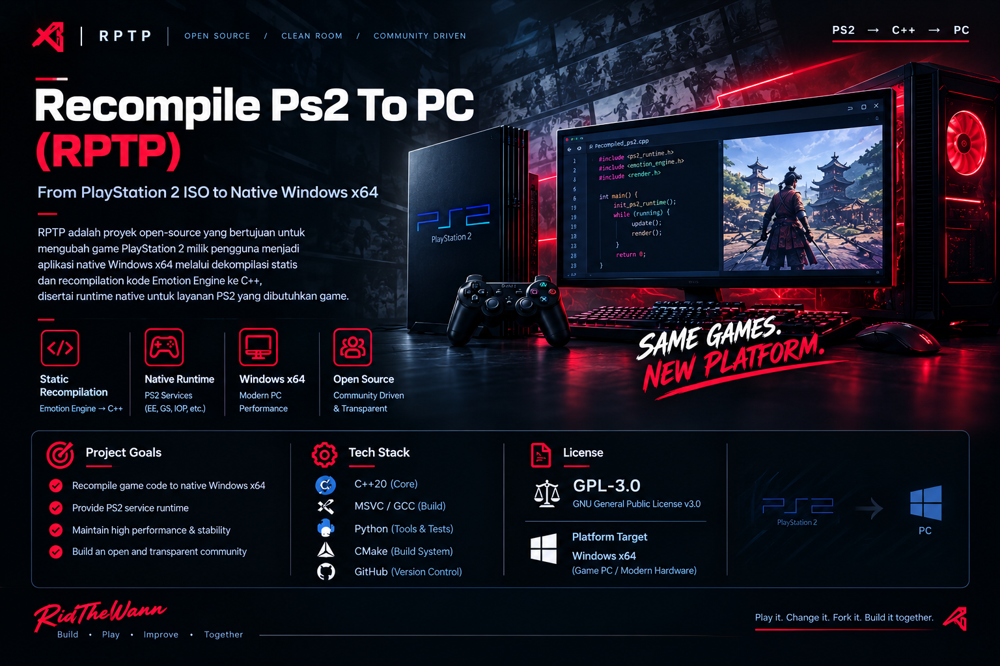

# Recompile Ps2 To PC (RPTP)



The repository keeps exactly one cover reference in this README, pointing at `docs/assets/rptp-cover.png`.

**From PlayStation 2 ISO to native Windows x64 — through static recompilation.**

RPTP is an open-source research project exploring how to transform a user-owned PlayStation 2 game image into a native Windows x64 build by statically recompiling supported Emotion Engine (EE) code to C++, alongside a from-scratch runtime for the PS2 services a game needs.

> **Development status: early research.** Gate 0 is a technical pass only for its narrow synthetic differential fixture. The catalog now records 42 catalogued synthetic instructions: the original 28, including `ANDI`/`ORI`/`XORI`, `LUI`, `SLL`, `AND`/`OR`/`XOR`/`NOR`, `SLT`/`SLTU`, `SLTI`/`SLTIU`, `DADDIU`/`DADDU`, `SUBU` and the aligned `LD`/`SD` doubleword pair, plus the six ordinary branch forms `BLEZ`, `BGTZ`, `BLTZ`, `BGEZ`, `BLTZAL` and `BGEZAL`, whose delay slot always executes, and the eight branch-likely forms `BEQL`, `BNEL`, `BLEZL`, `BGTZL`, `BLTZL`, `BGEZL`, `BLTZALL` and `BGEZALL`, whose delay slot executes only when the branch is taken; the catalog and evidence are in [`docs/INSTRUCTION_CATALOG.md`](docs/INSTRUCTION_CATALOG.md) and [`docs/VERIFICATION_LOG.md`](docs/VERIFICATION_LOG.md). The native harness covers the original 28 instructions plus the six ordinary and eight branch-likely forms with the documented delay-slot behavior and enforces the 4-byte `LW`/`SW` and 8-byte `LD`/`SD` alignment policy; the oracle, generated C++ and `rptp-run` are compared on one shared synthetic program. The latest merges through PR #49 (merge `be8269e`, run `40959803393`) passed on Windows x64/MSVC and Linux/GCC. The published [progress page](https://ridthewann.github.io/RPTP-Project/progress.html) and its README images are generated from the newest verification-log date and the catalogued instruction count (PRs #24, #26 and #27). These are Gate 3 synthetic tests, not a product loader, complete R5900 recompiler, clean-room certification, or evidence any commercial game boots or runs.

## Project goals

- Recompile supported EE code into native C++ and build for Windows x64.
- Implement the required PS2 runtime services independently, incrementally and with tests.
- Prioritize measured correctness, performance, reproducibility and compatibility over broad unsupported claims.
- Keep the implementation from scratch; do not copy emulator or recompiler implementation source.
- Build an open, transparent project that can be inspected, tested and improved by the community.

## Current status

[](https://ridthewann.github.io/RPTP-Project/progress.html) [](https://ridthewann.github.io/RPTP-Project/progress.html)

[](https://ridthewann.github.io/RPTP-Project/progress.html)

*Foundation (18 items) and runtime (20 items) are scope checklists; policy decisions are recorded in the ADRs and are not counted as verified. Percentages are not overall completion, boot support or game compatibility.*

### Gate 0 — synthetic recompilation spike

**Technical spike: passed on Windows x64/MSVC and Linux host compilers. Gate 0 is accepted as a technical pass for the narrow synthetic scope by explicit owner delegation on 2026-10-23. This is not a clean-room certification, an independent review or a Gate 2 disposition.**

The published spike currently demonstrates:

- A generated, manifest-registered synthetic ELF32/EM_MIPS test fixture.
- Basic ELF header and executable-segment bounds checks.
- A limited instruction subset: `ADDIU`, `ADDU`, `LW`, `SW`, `BEQ`, `BNE`, `J`, `JAL`, `JR` and `NOP`.
- A reference interpreter and deterministic C++ generation.
- Native-vs-oracle comparison of tested register state, memory writes, final PC/halt state and executed-PC trace, including tested delay-slot behavior.
- An artifact guard and the Gate 0 unit tests.

The Windows run used MSVC x64 with C++20 and strict warnings. Both `windows_msvc_verified` and `native_matches_oracle` were true in the run report. The tested native trace contains 22 steps.

**Not implemented or proven:** retail ISO compatibility/boot, full R5900 semantics, function discovery for real games, EE kernel/syscalls, VU, GS graphics, IOP, CDVD, audio, controller, memory card, timing, or commercial-game compatibility. The ISO inspector prototype below is not a game loader and does not establish disc compatibility.

### Synthetic IR lowering (Gate 3, in progress)

RPTP now has a separate deterministic lowering path for the same synthetic subset. The IR is validated, then emitted as a PC-keyed C++20 state machine that preserves the tested delay-slot model, register behavior and bounded memory. The generated program produces deterministic JSON and exits 2 on an uninitialized load.

The native lowering fixture has 29 instructions and executes 26 PCs; a separate dynamic-`JR` fixture executes 13; an 18-instruction logical-immediate fixture covers zero-extended `ANDI`/`XORI` masking, toggling, `$zero`, overlap and boundary behavior; a 9-instruction `LUI` fixture covers shifted/sign-extended immediate boundaries, `$zero` and malformed-input rejection; a 24-instruction register-logical fixture covers full 64-bit `AND`/`OR`/`XOR` results, upper-bit patterns, `$zero`, aliasing and malformed-input rejection; a 16-instruction `NOR` fixture covers full 64-bit complement-of-union results, upper-bit patterns, `$zero`, source/destination aliasing and malformed-input rejection; a 20-instruction `SLT` fixture covers signed 64-bit ordering, high-bit patterns, equality, `$zero`, aliasing and malformed-input rejection, with a direct helper check for `INT64_MIN`/`INT64_MAX` boundaries; a 26-instruction `SLTU` fixture covers unsigned 64-bit ordering, bit-31/bit-63 divergence, equality, all-ones, `$zero`, aliasing and malformed-input rejection, with a direct helper check for unsigned boundaries. A separate 24-instruction `SLTI` fixture tests signed comparison against sign-extended immediates; a 21-instruction `SLTIU` fixture tests the same immediate extension with unsigned comparison, including `UINT64_MAX` boundaries. A 17-instruction `SLL` fixture covers shift boundaries; a 19-instruction `DADDU` fixture covers full 64-bit addition and wraparound; a 20-instruction `SUBU` fixture distinguishes 32-bit subtraction from a 64-bit one; a 20-instruction `LD`/`SD` fixture covers aligned doubleword transfers, sign-extended and positive word pairs, negative offsets and `$zero` source/destination behavior; the `DADDIU` fixture covers positive and negative signed-32-bit boundary crossings. All generated programs match the oracle under MSVC for registers, memory, stop PC, halt state and executed-PC trace. A separate static reachability report traverses only the CFG's existing successor edges from an explicit validated block root; it synthesizes no edges and reports unresolved indirect transfers and direct calls. A separate eight-form branch-likely fixture covers taken and not-taken delay-slot nullification through the newer `tools/rptp` path in `tests/test_instruction_branch_likely.py`; the older `rptp_lower.py` path remains unchanged. The generated source and reachability output are test artifacts, not product code: there is still no function discovery, real-game code generation, runtime or compatibility claim. See [the IR/CFG and lowering contract](docs/IR_CFG.md).

## ISO Inspector prototype

RPTP now includes a read-only command-line ISO 9660 inspector for an image you are authorized to use. It reads the primary volume descriptor, locates root `SYSTEM.CNF`, resolves its `BOOT2` (or legacy `BOOT`) path, checks the boot file's ELF32 header, program-header table and PT_LOAD file bounds, and reports SHA-256 digests for `SYSTEM.CNF` and the boot file. It does not extract files, modify the ISO, execute the ELF, or recompile a game.

```powershell
python tools/rptp_inspect.py "D:\Games\your-owned-game.iso"
python tools/rptp_inspect.py "D:\Games\your-owned-game.iso" --json
```

The inspector currently supports single-volume ISO 9660 images with 2048-byte logical blocks and rejects multi-extent entries explicitly. It is a first ISO-inspection milestone, not proof of compatibility with all PS2 disc layouts. Synthetic tests cover valid metadata, malformed-input paths, deterministic mutation smoke and CLI JSON behavior; the current owner-authorized retail sample has been inspected read-only, but no boot or native port has been validated. No commercial ISO is included in the repository.

Every game RPTP works on gets a durable record under [docs/games](docs/games/README.md). The record tracks inspection, boot-analysis, runtime and playability status; game images and extracted assets are never committed.

## Native runtime foundation

RPTP now has its first native C++20 layer. `rptp_runtime` implements sparse guest memory and a fail-closed ELF32 little-endian `ET_EXEC`/`EM_MIPS` loader: `PT_LOAD` header, bounds, alignment, address-space, order and overlap checks, zero-fill for `p_memsz - p_filesz`, and an entry point that must be file-backed and executable. The `rptp-load` CLI reports a loaded image as deterministic `rptp.runtime.load.v1` JSON with stable `LOAD_*` error codes.

A separate synthetic execution harness (`rptp-run`, `rptp.runtime.run.v1` JSON) executes only the documented synthetic subset — the Gate 0 instructions plus `SLL`, `SLT`, `SLTU`, `SLTI`, `SLTIU`, `DADDIU`, `DADDU`, `SUBU`, `AND`, `OR`, `XOR`, `NOR`, `ANDI`, `ORI`, `XORI`, `LUI` and aligned `LD`/`SD`, with one delay slot after each control transfer — on top of the loader, and is checked against the Python oracle. It fails explicitly on unsupported instructions, unmapped or unaligned memory, bad control flow and step-budget exhaustion.

This layer is a differential-test vehicle, not the product runtime. It implements no kernel, syscalls, IOP, DMA, VU, GS, SPU2, ISO ingestion or compatibility behavior, and it has only been tested on synthetic images and the Gate 0 fixture. See [docs/RUNTIME.md](docs/RUNTIME.md) for the contract, limits and non-goals.

## Releases

Release tags and release artifacts are created only from release-ready commits with green CI. Force-pushes and history rewrites are prohibited.

## Development phases

1. **Gate 0 — Foundation and spike:** technical differential test completed and CI verified; the narrow technical pass was recorded on 2026-10-23 by explicit owner delegation. The [decision evidence package](docs/GATE0_REVIEW.md) records the accepted scope and limits; the [provenance execution plan](docs/PROVENANCE_PLAN.md) records the independent reviews that remain before release.
2. **B1a — Project foundation:** license and architecture decision recorded; the owner confirmed GPL-3.0-or-later on 2026-10-21. Clean-room handling is governed by the owner-approved sealed-source policy in ADR-0003; prior exposure remains documented.
3. **B1b — Repository/toolchain baseline:** CMake, diagnostics, tests and CI are implemented; the latest merge `be8269e` (PR #49, run `40959803393`) passed Windows x64/MSVC and Linux/GCC. The build/CI/doctor clean-room review remains open (`Review required`).
4. **B1c — ISO Inspector prototype:** read-only ISO9660 and `SYSTEM.CNF` inspection, boot metadata, an explicit error taxonomy, ELF PT_LOAD checks, hashing and synthetic malformed-input tests are implemented. A broader owner-authorized real-disc sample is recorded; ISO-variant review, the independent ISO inspector provenance review and the read-only Gate 2 disposition remain open. Gate 2 is read-only per [ADR-0004](docs/DECISIONS/ADR-0004-gate2-read-only-scope.md); extraction is deferred future work.
5. **B2a — Native runtime foundation (in progress):** sparse guest memory, a fail-closed synthetic-image ELF32 loader and a synthetic execution harness in C++20, with deterministic CLIs and CTest coverage. No product runtime, kernel, syscall, boot or compatibility evidence yet.
6. **Recompiler MVP (in progress):** the 42-instruction synthetic catalog (including `SLL`, `DADDIU`, `DADDU`, `SUBU`, aligned `LD`/`SD`, the six ordinary branch forms and the eight branch-likely forms), per-family differential fixtures, the minimal IR/CFG contract with candidate-only function entries, conservative known-edge traversal, and deterministic synthetic IR-to-C++ lowering are recorded. Function discovery, real-game generation, runtime and game-boot evidence remain absent; Gate 3 is not passed.
7. **First-game vertical slice:** boot, minimum runtime services, graphics, audio/input/save and repeatable gameplay.
8. **Compatibility and release:** expand subsystem coverage using measured blockers, then validate clean-machine builds and release artifacts.

The detailed plan and pass criteria live in [docs/ROADMAP.md](docs/ROADMAP.md). See [docs/STATE.md](docs/STATE.md) for current evidence and limitations.

## Build and test the Gate 0 spike

Requirements: Python 3.10+, CMake 3.25+, Ninja, and a C++20 compiler. On Windows, use Developer PowerShell for Visual Studio or an x64 Native Tools command prompt.

The CMake presets provide the repeatable project checks:

    cmake --preset windows-msvc
    cmake --build --preset windows-msvc

On Linux with GCC or Clang:

    cmake --preset host
    cmake --build --preset host

The build preset runs the environment doctor, artifact guard, unit tests and Gate 0 differential test. See docs/BUILDING_WINDOWS.md for details.

### Windows / MSVC

```powershell
python tools\check_forbidden_artifacts.py --root .
python tools\rptp_gate0_spike.py --out build\gate0-msvc --compiler cl
python -m unittest discover -s tests -v
```

Or run the repository wrapper:

```powershell
powershell -NoProfile -ExecutionPolicy Bypass -File .\scripts\run-msvc.ps1
```

### Linux / GCC

```bash
python3 tools/check_forbidden_artifacts.py --root .
python3 -m unittest discover -s tests -v
python3 tools/rptp_gate0_spike.py --out build/gate0 --compiler g++
```

Build outputs are local and should not be committed. Only synthetic binary fixtures explicitly registered in `tests/fixtures/MANIFEST` are permitted; do not add commercial ISOs, BIOS files, game executables, or proprietary assets.

## Architecture and clean-room boundaries

- **Approach:** from-scratch static ahead-of-time recompilation; native Windows x64 target.
- **Generated output:** C++ compiled by the target host toolchain.
- **Verification:** deterministic output, reference-oracle differential tests, fixture hashes and explicit unsupported-instruction errors.
- **Clean room:** do not copy implementation source from emulators or recompilers. Prior technical-source exposure is documented in [docs/REFERENCES.md](docs/REFERENCES.md) and [ADR-0001](docs/DECISIONS/ADR-0001-foundation-and-clean-room.md); it must not be ignored or represented as erased. The owner-approved [ADR-0003](docs/DECISIONS/ADR-0003-sealed-source-clean-room-policy.md) seals those projects: no further access, and new work must be independently derived from neutral specifications and tests. Component-level status is in [docs/CLEAN_ROOM_AUDIT.md](docs/CLEAN_ROOM_AUDIT.md); the execution steps and remaining independent reviews are in [docs/PROVENANCE_PLAN.md](docs/PROVENANCE_PLAN.md). This is a process policy, not a legal guarantee.

## License

Original RPTP project material is offered under **GNU GPL-3.0-or-later**, subject to the license text and applicable notices. See [LICENSE](LICENSE) and [docs/LICENSES.md](docs/LICENSES.md). Third-party material retains its own license. This project license does not grant rights to distribute PS2 BIOS files, commercial game images, proprietary assets, or game-derived output.

## Contributing

Start with the current state, roadmap, risk register and architecture decisions; the [documentation map](docs/README.md) lists every document. Each increment must update all affected documents before merge. Submit reproducible evidence with changes; keep claims proportional to tests. New binary fixtures require a manifest entry documenting their synthetic origin, hash and license status.

**Play it. Change it. Fork it. Build it together.**
