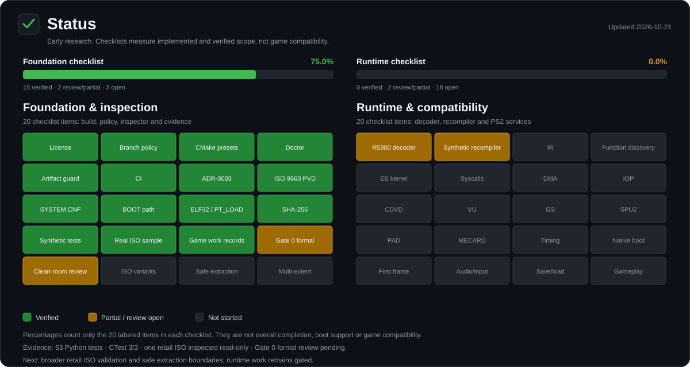

# Recompile Ps2 To PC (RPTP)


**From PlayStation 2 ISO to native Windows x64 — through static recompilation.**

RPTP is an open-source research project exploring how to transform a user-owned PlayStation 2 game image into a native Windows x64 build by statically recompiling supported Emotion Engine (EE) code to C++, alongside a from-scratch runtime for the PS2 services a game needs.

> **Development status: early research.** The published Gate 0 spike is a narrow, passing synthetic differential test, and main-branch CI is green on both supported CI jobs. This is not a PS2 game loader, a complete R5900 recompiler, or evidence that any commercial game boots or runs.

## Status

[](docs/assets/rptp-status.svg)

The dashboard separates the verified foundation and inspection checklist from the still-unimplemented runtime checklist. Its percentages are scope labels for those checklists, not overall completion or game compatibility. The SVG is generated by `python tools/rptp_status.py`; workload evidence is tracked in [docs/STATE.md](docs/STATE.md) and [docs/ROADMAP.md](docs/ROADMAP.md).

## Project goals

- Recompile supported EE code into native C++ and build for Windows x64.
- Implement the required PS2 runtime services independently, incrementally and with tests.
- Prioritize measured correctness, performance, reproducibility and compatibility over broad unsupported claims.
- Keep the implementation from scratch; do not copy emulator or recompiler implementation source.
- Build an open, transparent project that can be inspected, tested and improved by the community.

## Current status

### Gate 0 — synthetic recompilation spike

**Technical spike: passed on Windows x64/MSVC and Linux host compilers. Formal Gate 0 acceptance: pending owner review.**

The published spike currently demonstrates:

- A generated, manifest-registered synthetic ELF32/EM_MIPS test fixture.
- Basic ELF header and executable-segment bounds checks.
- A limited instruction subset: `ADDIU`, `ADDU`, `LW`, `SW`, `BEQ`, `BNE`, `J`, `JAL`, `JR` and `NOP`.
- A reference interpreter and deterministic C++ generation.
- Native-vs-oracle comparison of tested register state, memory writes, final PC/halt state and executed-PC trace, including tested delay-slot behavior.
- An artifact guard and 12 unit tests.

The Windows run used MSVC x64 with C++20 and strict warnings. Both `windows_msvc_verified` and `native_matches_oracle` were true in the run report. The tested native trace contains 22 steps.

**Not implemented or proven:** retail ISO compatibility/boot, full R5900 semantics, function discovery for real games, EE kernel/syscalls, VU, GS graphics, IOP, CDVD, audio, controller, memory card, timing, or commercial-game compatibility. The ISO inspector prototype below is not a game loader and does not establish disc compatibility.

## ISO Inspector prototype

RPTP now includes a read-only command-line ISO 9660 inspector for an image you are authorized to use. It reads the primary volume descriptor, locates root `SYSTEM.CNF`, resolves its `BOOT2` (or legacy `BOOT`) path, checks the boot file's ELF32 header, program-header table and PT_LOAD file bounds, and reports SHA-256 digests for `SYSTEM.CNF` and the boot file. It does not extract files, modify the ISO, execute the ELF, or recompile a game.

```powershell
python tools/rptp_inspect.py "D:\Games\your-owned-game.iso"
python tools/rptp_inspect.py "D:\Games\your-owned-game.iso" --json
```

The inspector currently supports single-volume ISO 9660 images with 2048-byte logical blocks and rejects multi-extent entries explicitly. It is a first ISO-inspection milestone, not proof of compatibility with all PS2 disc layouts. Synthetic tests cover valid metadata, malformed-input paths, deterministic mutation smoke and CLI JSON behavior; one owner-authorized retail ISO has been inspected read-only, but no boot or native port has been validated. No commercial ISO is included in the repository.

Every game RPTP works on gets a durable record under [docs/games](docs/games/README.md). The record tracks inspection, boot-analysis, runtime and playability status; game images and extracted assets are never committed.

## Branches and releases

RPTP has exactly two long-lived branches. `development` is the integration and work branch; `main` is release-only and receives changes only through a reviewed `development -> main` pull request. Direct commits, force-pushes and release tags on `development` are prohibited, and no other branches are permitted. See [docs/BRANCH_POLICY.md](docs/BRANCH_POLICY.md).

## Development phases

1. **Gate 0 — Foundation and spike:** technical differential test completed and CI verified; formal review remains open.
2. **B1a — Project foundation:** license and architecture decision recorded; the owner confirmed GPL-3.0-or-later on 2026-10-21. Clean-room handling is governed by the owner-approved sealed-source policy in ADR-0003; prior exposure remains documented.
3. **B1b — Repository/toolchain baseline:** CMake, diagnostics, tests and CI are implemented; main and development CI are green, and the clean-checkout local Windows run passed. The clean-room review of the build/CI/doctor layer remains open.
4. **B1c — ISO Inspector prototype:** read-only ISO9660 and `SYSTEM.CNF` inspection, boot metadata, an explicit error taxonomy, ELF PT_LOAD checks, hashing and synthetic malformed-input tests are implemented. An initial real-disc inspection is recorded for Downhill Domination (USA); broader validation and the Gate 2 work (including safe extraction boundaries) remain open.
5. **Recompiler MVP:** verified instruction catalog, decoder, IR, function discovery, deterministic code generation and differential tests.
6. **First-game vertical slice:** boot, minimum runtime services, graphics, audio/input/save and repeatable gameplay.
7. **Compatibility and release:** expand subsystem coverage using measured blockers, then validate clean-machine builds and release artifacts.

The detailed plan and pass criteria live in [docs/ROADMAP.md](docs/ROADMAP.md). See [docs/STATE.md](docs/STATE.md) for current evidence and limitations.

## Build and test the Gate 0 spike

Requirements: Python 3.10+, CMake 3.25+, Ninja, and a C++20 compiler. On Windows, use Developer PowerShell for Visual Studio or an x64 Native Tools command prompt.

The CMake presets provide the repeatable project checks:

    cmake --preset windows-msvc
    cmake --build --preset windows-msvc

On Linux with GCC or Clang:

    cmake --preset host
    cmake --build --preset host

The build preset runs the environment doctor, artifact guard, unit tests and Gate 0 differential test. See docs/BUILDING_WINDOWS.md for details.

### Windows / MSVC

```powershell
python tools\check_forbidden_artifacts.py --root .
python tools\rptp_gate0_spike.py --out build\gate0-msvc --compiler cl
python -m unittest discover -s tests -v
```

Or run the repository wrapper:

```powershell
powershell -NoProfile -ExecutionPolicy Bypass -File .\scripts\run-msvc.ps1
```

### Linux / GCC

```bash
python3 tools/check_forbidden_artifacts.py --root .
python3 -m unittest discover -s tests -v
python3 tools/rptp_gate0_spike.py --out build/gate0 --compiler g++
```

Build outputs are local and should not be committed. Only synthetic binary fixtures explicitly registered in `tests/fixtures/MANIFEST` are permitted; do not add commercial ISOs, BIOS files, game executables, or proprietary assets.

## Architecture and clean-room boundaries

- **Approach:** from-scratch static ahead-of-time recompilation; native Windows x64 target.
- **Generated output:** C++ compiled by the target host toolchain.
- **Verification:** deterministic output, reference-oracle differential tests, fixture hashes and explicit unsupported-instruction errors.
- **Clean room:** do not copy implementation source from emulators or recompilers. Prior technical-source exposure is documented in [docs/REFERENCES.md](docs/REFERENCES.md) and [ADR-0001](docs/DECISIONS/ADR-0001-foundation-and-clean-room.md); it must not be ignored or represented as erased. The owner-approved [ADR-0003](docs/DECISIONS/ADR-0003-sealed-source-clean-room-policy.md) seals those projects: no further access, and new work must be independently derived from neutral specifications and tests. Component-level status is in [docs/CLEAN_ROOM_AUDIT.md](docs/CLEAN_ROOM_AUDIT.md). This is a process policy, not a legal guarantee.

## License

Original RPTP project material is offered under **GNU GPL-3.0-or-later**, subject to the license text and applicable notices. See [LICENSE](LICENSE) and [docs/LICENSES.md](docs/LICENSES.md). Third-party material retains its own license. This project license does not grant rights to distribute PS2 BIOS files, commercial game images, proprietary assets, or game-derived output.

## Contributing

Start with the current state, roadmap, risk register and architecture decisions. Submit reproducible evidence with changes; keep claims proportional to tests. New binary fixtures require a manifest entry documenting their synthetic origin, hash and license status.

**Play it. Change it. Fork it. Build it together.**
